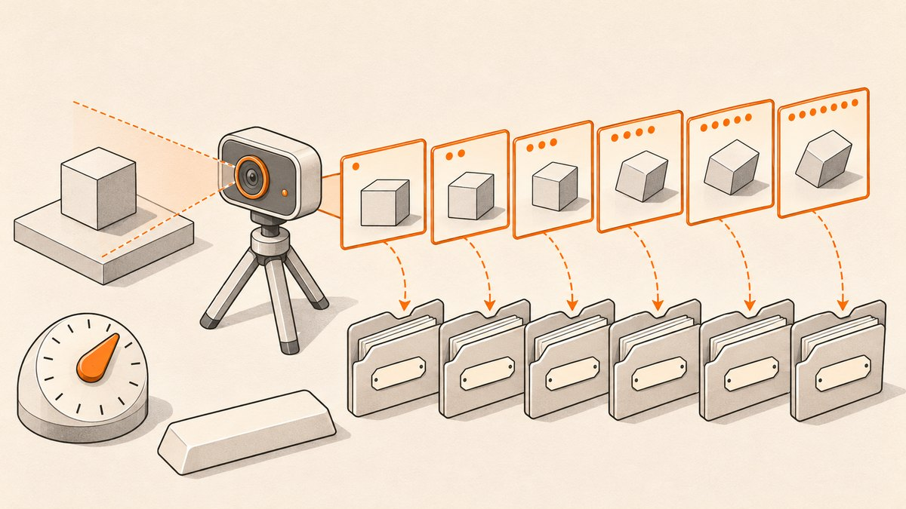

<p align="center"></p>

# Webcam Dataset Creator

A small OpenCV script that captures labelled webcam images for building an image classification dataset.

## What it does

- Asks for a class label, a capture mode and an output folder, then saves webcam frames as `<LABEL>_<n>.png`.
- **Manual mode:** shows the live feed; press Space to save a frame, Esc to stop.
- **Auto mode:** waits a start delay, then saves a set number of frames with a fixed pause between captures. Esc stops early.
- Creates the output folder if it does not exist.

## How it works

`create.py` prompts for each setting with `input()`. Every setting can be pre-filled instead by uncommenting the config lines at the top of the file (`mode`, `images`, `delay`, `delaybetween`, `path`); the script only prompts for values that are not already defined. The label is upper-cased. Frames come from `cv2.VideoCapture(0)` (requested at 300x300) and are written with `cv2.imwrite`.

## Tech

- Python 3
- OpenCV (`cv2`)

## Run it

Needs a webcam.

```bash
pip install opencv-python
python create.py
```

Example session: label `cat`, mode `auto`, 50 images, 10 s start delay, 0.5 s between shots, folder `train`. This writes `train/CAT_0.png` to `train/CAT_49.png`.

## Project structure

- `create.py`: the whole tool (prompts, preview window, capture loop).
- `requirements.txt`: pinned dependencies (`numpy==1.16.1`, `opencv-python==4.0.0.21`).

## Notes

- The pinned versions in `requirements.txt` are from 2019 and will not install on current Python releases; installing a recent `opencv-python` works for this script.
- If you leave the folder name blank, file names become `/<LABEL>_<n>.png`, which points at the root of the drive rather than the current folder. Always give a folder name.
- Re-running with the same label starts numbering at 0 again and overwrites existing files.
- Inputs are not validated, so a non-numeric image count or delay raises an error.
